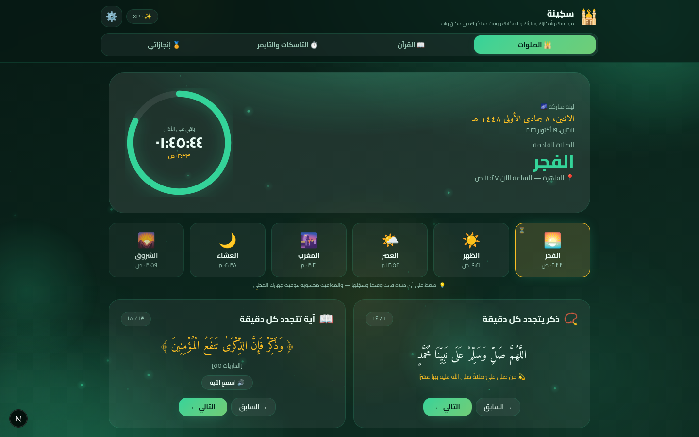
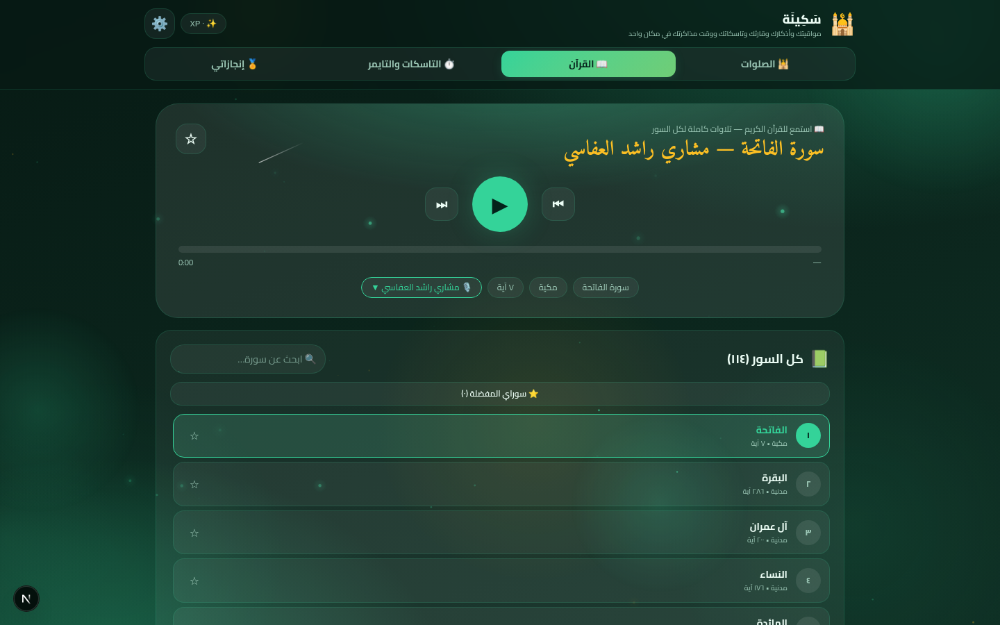
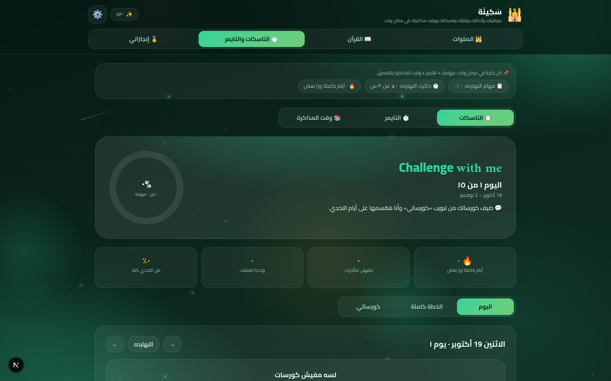
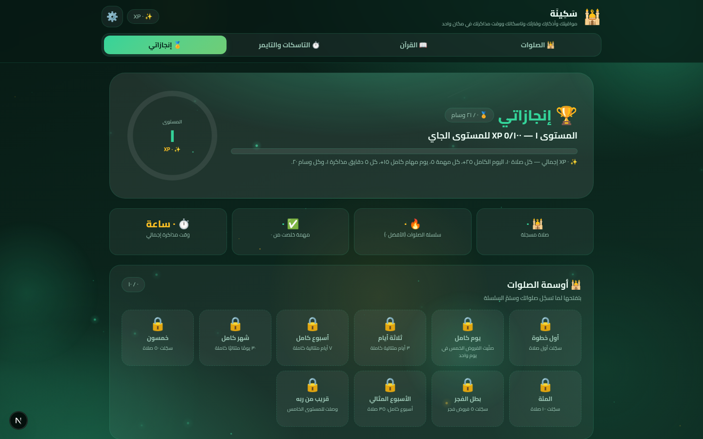
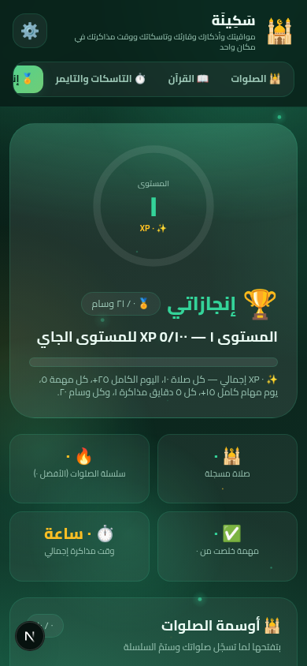

# 🕌 سَكِينَة | Sakinah

> تطبيق ويب إسلامي شامل + نظام تحدي مذاكرة — في مكان واحد منظم

**سَكِينَة** تطبيق ويب متكامل يجمع بين العبادات والتنظيم والإنتاجية: مواقيت الصلاة التلقائية، القرآن الكريم بأصوات نخبة القراء، الأذكار المتجددة، ونظام تحدي مذاكرة كامل بالمهام والتايمر والأوسمة — كل ذلك بواجهة عربية (RTL) جميلة مع ثيمات متعددة وأنميشنات هادئة.

---

## ✨ المميزات

### 🕌 الصلوات
- **مواقيت الصلاة تلقائيًا** حسب موقعك (GPS أو إحداثيات يدوية) بخمس طرق حساب مختلفة
- عداد حي للصلاة القادمة + التاريخ الهجري + اتجاه القبلة
- نافذة **«هل صليت؟»** بعد كل صلاة: تأكيد = نقاط XP + ألعاب نارية 🎆 + تهنئة / رفض = نصيحة مؤثرة + آية قرآنية
- **الأذان** بصوت mp3 حقيقي مع عدة أصوات للاختيار + نغمة احتياطية محلية
- سجل صلوات 90 يومًا + سلسلة الأيام المتتالية

### 📖 القرآن الكريم
- **١٧ قارئًا** نخبة (العفاسي، عبد الباسط، الحصري، المنشاوي، ماهر المعيقلي، سعد الغامدي...)
- كل السور (١١٤) مع مشغل تلاوة كامل (تشغيل/إيقاف/سابق/تالي/شريط تقدم قابل للسحب)
- تشغيل تلقائي متسلسل للسور + بحث + مفضلة + تلاوة الآيات المفردة

### ⏱️ التاسكات والتايمر ووقت المذاكرة
- كورسات دراسية بتوزيع تلقائي على الأيام + مهام يومية قابلة للتعديل
- تايمر مذاكرة **مربوط بالمهام**: شغّل الجلسة من المهمة مباشرة، والوقت يُجمع عليها
- التايمر يستمر حتى بعد إغلاق الصفحة (timestamp-based)
- صفحة **وقت المذاكرة** بالإحصائيات: إجمالي الأسبوع، المتوسط اليومي، أفضل يوم، رسم بياني بخط الهدف، الوقت حسب المادة، آخر ٣٠ جلسة

### 🏅 إنجازاتي
- نظام **XP** موحد: صلاة +١٠، مهمة +٥، كل ٥ دقائق مذاكرة +١، وسام جديد +٢٠
- مستويات تتقدم تلقائيًا (كل ١٠٠ XP)
- **٢١ وسامًا** مقسمة على أوسمة الصلوات وأوسمة المذاكرة والمهام

### ⚙️ الإعدادات والمظهر
- **٩ ثيمات جاهزة** + تغيير الألوان حسب مزاجك بحرية كاملة
- مفتاح تحكم في الأنميشنات (خلفية متحركة بالنجوم، ألعاب نارية...)
- كل شيء يُحفظ محليًا في المتصفح (localStorage) — بياناتك عندك وحدك

---

## 📸 لقطات الشاشة

| الصلوات | القرآن |
|:---:|:---:|
|  |  |

| التاسكات والتايمر ووقت المذاكرة | إنجازاتي |
|:---:|:---:|
|  |  |



---

## 🛠️ التقنيات المستخدمة

| التقنية | الإصدار |
|---|---|
| [Next.js](https://nextjs.org) (App Router) | 16 |
| [React](https://react.dev) | 19 |
| [TypeScript](https://typescriptlang.org) | 5 |
| [Tailwind CSS](https://tailwindcss.com) | 4 |
| [Prisma](https://prisma.io) | 6 |

---

## 🚀 التشغيل محليًا

```bash
# 1) نسخ المشروع
git clone https://github.com/USERNAME/sakinah.git
cd sakinah

# 2) تثبيت الحزم
npm install
# أو
bun install

# 3) تشغيل وضع التطوير
npm run dev

# 4) افتح المتصفح على
# http://localhost:3000
```

> 💡 التطبيق يعمل بالكامل دون قاعدة بيانات — كل بياناتك (الصلوات، المهام، الجلسات، الأوسمة، الثيمات) تُحفظ محليًا في متصفحك عبر localStorage.

### بناء نسخة الإنتاج

```bash
npm run build
npm start
```

---

## 📁 هيكل المشروع

```
src/
├── app/                    # صفحات Next.js (App Router)
│   ├── layout.tsx          # التخطيط الرئيسي + سكريبت الثيم
│   ├── page.tsx            # الصفحة الرئيسية
│   └── api/                # مسارات API
├── components/
│   ├── sakinah-app.tsx     # المكوّن الرئيسي + التنقل + XP الموحد
│   ├── focus-section.tsx   # قسم التاسكات + التايمر + وقت المذاكرة (مدمج)
│   ├── tasks-section.tsx   # الكورسات والمهام اليومية
│   ├── timer-section.tsx   # التايمر والإحصائيات
│   ├── study-section.tsx   # صفحة وقت المذاكرة التفصيلية
│   ├── achievements-section.tsx  # إنجازاتي (XP + الأوسمة)
│   ├── quran-section.tsx   # مشغل القرآن + القراء
│   ├── animated-background.tsx   # خلفية النجوم المتحركة
│   └── settings-section.tsx# الثيمات والإعدادات
└── lib/
    ├── planner.ts          # منطق المهام/التايمر/XP/الجلسات
    ├── quran.ts            # القراء والسور وروابط التلاوة
    └── data.ts             # الأذكار والآيات والأوسمة
```

---

## 📄 الترخيص

هذا المشروع مفتوح المصدر لأغراض تعليمية وخيرية — بارك الله في كل من يستفيد منه ويطوره. 🤲
